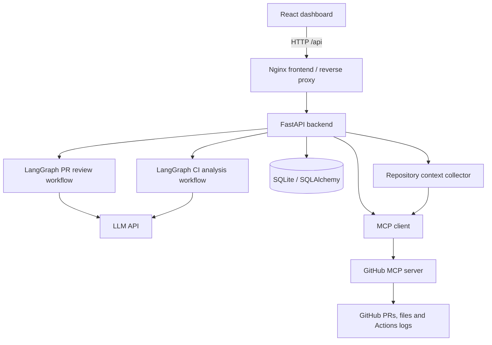

# DevPilot AI

**An MCP-powered developer productivity assistant for AI-assisted pull request reviews and GitHub Actions failure investigation.**

DevPilot AI connects to GitHub through the Model Context Protocol (MCP), orchestrates AI analysis with LangGraph, and presents actionable reports in a React dashboard. It can examine pull request diffs, investigate failed CI runs using job logs **and repository files from the failing commit**, and save reports for later viewing without repeating the LLM request.

> **Project status:** Working local, Docker Compose-based MVP. This is not yet a hosted multiuser service. GitHub access is read-only and restricted to the repository configured in the backend environment.

## Features

| Feature | What it does |
| --- | --- |
| **AI pull request review** | Fetches PR metadata and changed-file patches using GitHub MCP, then generates structured findings, severity, location and suggested fixes. |
| **CI failure investigation** | Retrieves historical GitHub Actions runs and failed job logs, then produces a root-cause report with evidence and recommended action. |
| **Repository-aware diagnosis** | Fetches workflow configuration and relevant repository files at the failed run's commit SHA to distinguish immediate errors from underlying issues. |
| **Analysis history** | Persists reports to SQLite with SQLAlchemy; previously saved results can be reopened without another LLM call. |
| **Web dashboard** | React + Vite interface with Pull Request Review, CI Failure Analysis and Analysis History views. |
| **Containerized local deployment** | Runs FastAPI and an Nginx-served React build with Docker Compose, with persisted database storage. |

## Architecture



**Review flow:** PR number → GitHub MCP `pull_request_read` → changed-file diff → LangGraph reviewer → validated report → SQLite → dashboard.

**CI flow:** Workflow run ID → GitHub MCP Actions tools → failure logs and failing commit SHA → repository context collector → LangGraph investigator → report → SQLite → dashboard.

The current LangGraph workflows invoke defined analysis nodes; the project does **not** claim autonomous code changes, automatically approved fixes, or test execution by an LLM.

## Technology stack

- **AI / orchestration:** OpenAI API, LangGraph, Pydantic structured outputs
- **Tool integration:** Model Context Protocol Python SDK, hosted GitHub MCP server (read-only)
- **Backend:** Python 3.13, FastAPI, SQLAlchemy, SQLite
- **Frontend:** React, Vite, CSS
- **DevOps:** GitHub Actions, pytest, Docker, Docker Compose, Nginx

## Repository layout

```text
devpilot-ai/
├── backend/
│   ├── app/
│   │   ├── main.py                    # REST endpoints
│   │   ├── database.py                # SQLite models and sessions
│   │   ├── agents/
│   │   │   ├── review_agent.py        # PR reviewer
│   │   │   └── ci_agent.py            # CI investigator
│   │   ├── services/
│   │   │   ├── github_service.py      # Authenticated MCP client
│   │   │   ├── repository_context.py  # Historical repository context
│   │   │   └── ci_analysis.py         # CLI CI investigation utility
│   │   └── mcp_clients/
│   │       └── github_client.py
│   ├── mcp_servers/
│   │   └── docs_server.py             # Example custom MCP server
│   └── requirements.txt
├── frontend/
│   ├── src/
│   └── nginx.conf
├── tests/
│   └── test_api.py                    # API tests
├── Dockerfile.backend
├── Dockerfile.frontend
├── docker-compose.yml
├── .dockerignore
└── .env.example
```

## Prerequisites

- Python 3.13 (used during development)
- Node.js compatible with the installed Vite version and npm
- Docker Desktop and Docker Compose (for the containerized setup)
- GitHub personal access token with **read** access to repository contents, pull requests and Actions information
- An LLM API key with access to the model configured in `.env`

> Do not commit credentials. The configured GitHub repository is an allowlisted development target, not an arbitrary public-repository scanner.

## Configuration

Create `.env` in the project root (or copy `.env.example` and replace placeholders):

```dotenv
GITHUB_TOKEN=your_github_token_here
GITHUB_OWNER=jwerr
GITHUB_REPO=MCP_Server
OPENAI_API_KEY=your_openai_api_key_here
OPENAI_MODEL=your_api_enabled_model
```

`DATABASE_URL` is optional for local use. By default, the database is stored in `devpilot.db` in the project root. The Docker configuration sets `DATABASE_URL=sqlite:////app/data/devpilot.db` and mounts `./data` into the container.

The example `jwerr/MCP_Server` is a **sample repository used to test DevPilot AI**, not the DevPilot application repository itself.

## Run with Docker Compose

From the project root:

```bash
docker compose config --quiet
docker compose build
docker compose up -d
docker compose ps
```

Open:

- **Dashboard:** http://localhost:5173
- **API documentation:** http://localhost:8000/docs
- **Health check:** http://localhost:8000/health

View logs or stop the containers:

```bash
docker compose logs --tail=80
docker compose down
```

The SQLite data directory is mounted from `./data`, so reports persist across container restarts. Do **not** commit `data/` or any `.db` file.

## Run locally (without Docker)

**Backend:**

```bash
python3 -m venv .venv
source .venv/bin/activate
python -m pip install -r backend/requirements.txt
python -m uvicorn app.main:app --app-dir backend --host 127.0.0.1 --port 8000 --reload
```

**Frontend (in another terminal):**

```bash
cd frontend
npm install
npm run dev
```

Open the URL printed by Vite (usually http://localhost:5173). The Vite development proxy forwards `/api` calls to FastAPI.

## API reference

| Method | Endpoint | Description |
| --- | --- | --- |
| `GET` | `/health` | Backend health check |
| `POST` | `/api/review-pr` | Analyze a pull request and save the report |
| `POST` | `/api/analyze-ci` | Analyze a failed workflow run and save the report |
| `GET` | `/api/reports` | List recent saved reports |
| `GET` | `/api/reports/{report_id}` | Retrieve a saved report |

**PR review request:**

```json
{"owner":"jwerr","repo":"MCP_Server","pull_number":1}
```

**CI investigation request:**

```json
{"owner":"jwerr","repo":"MCP_Server","run_id":41312676761}
```

Each analysis endpoint returns the repository, analysis details and a `report_id` after saving. Open `/docs` to explore the current request and response schemas.

## Demonstrated CI failure

The development sample included a failing GitHub Actions run (`41312676761`). The workflow executed pytest from the repository root, which picked up an unrelated nested `devpilot-ai/backend/test_mcp.py`. Collection then failed with:

```text
ModuleNotFoundError: No module named 'mcp'
```

An initial log-only diagnosis correctly found the missing import but suggested installing the dependency. Adding **historical repository context** improved the recommendation: restrict test discovery to the intended `tests/` directory and remove unrelated nested project files. This illustrates why a technically correct error diagnosis can still lead to an inappropriate remediation without repository context.

That issue was corrected in the sample repository and later GitHub Actions runs passed. Report confidence is generated by the model and should not be treated as calibrated probability.

## Testing

Run local backend API tests from the project root:

```bash
source .venv/bin/activate
python -m pip install pytest httpx
PYTHONPATH=backend python -m pytest tests/test_api.py -v
```

The API tests are intended to mock GitHub MCP and LLM calls to avoid network access and usage charges. A GitHub Actions workflow can run these tests on each pull request. **Do not claim a particular pass count until the tests have been run and verified in this repository.**

Build the React app:

```bash
cd frontend
npm ci
npm run build
```

## Screenshots and demonstration

Add your own screenshots to `docs/screenshots/`, then uncomment or update these references:

```markdown
<!--  -->
<!--  -->
<!--  -->
```

**Suggested demo:** Open the dashboard → analyze PR #1 → investigate historical CI run `41312676761` → show evidence and the repository-aware recommendation → open the report from Analysis History without triggering another LLM call.

## Security and limitations

- **Local development only:** These endpoints do not yet implement user authentication or per-user report authorization. Do not expose this version directly to the public internet.
- **Read-only GitHub tools:** The MCP client requests read-only GitHub toolsets; the AI does not push commits, merge PRs or execute changes.
- **Untrusted inputs:** GitHub source files, diffs and logs may contain prompt-injection attempts. Treat them as data and retain output validation and tool permission boundaries.
- **Sensitive logs:** CI logs and saved reports can contain private code, metadata or secrets. Review and redact sensitive content; protect SQLite storage and backups.
- **Accuracy:** LLM findings and root-cause suggestions can be wrong. Verify suggested fixes using tests and engineer review.
- **Scope:** The current backend allowlists one configured GitHub owner/repository; workflow history retrieval is limited to recent runs.
- **Cost:** New AI analyses invoke an external model; reopening a saved report does not.

## Roadmap

- [x] GitHub MCP-based PR diff retrieval and review
- [x] GitHub Actions failure-log investigation
- [x] Repository-aware historical CI context
- [x] FastAPI + React dashboard
- [x] SQLite analysis history
- [x] Local Docker Compose deployment
- [ ] Verify automated backend tests in the DevPilot AI GitHub Actions workflow
- [ ] Add stronger evaluation datasets and quality metrics
- [ ] Implement authentication and report-level authorization
- [ ] Add rate limiting, secrets redaction and retention controls
- [ ] Deploy a secured hosted demo

## Related repository

- [MCP_Server](https://github.com/jwerr/MCP_Server) — sample repository and GitHub Actions test fixture used during development.

---

Built as an AI engineering portfolio project to demonstrate MCP tool integration, LangGraph orchestration, repository-aware failure analysis, backend APIs, and full-stack delivery.
